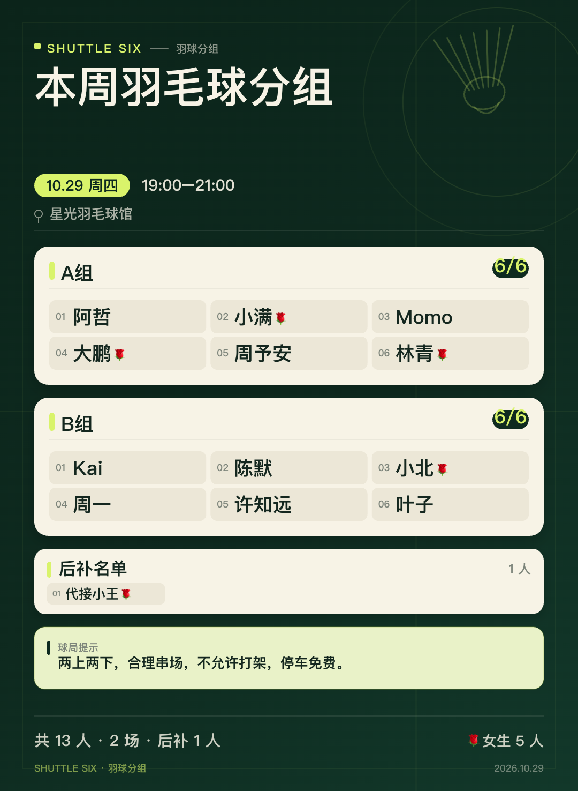

# 羽六 · 羽毛球接龙分组海报

移动端优先的纯前端小工具：粘贴微信羽毛球报名接龙，自动识别昵称与 🌹 女生标记，按每场 6 人拖拽分组，余下自动进入后补名单，选择时间场馆，一键生成可发群的高清海报。

无后端、无账号，所有数据只保存在当前浏览器。



## 功能

- **接龙识别**：支持 `1.` `1、` `1）` `1)` `1：` `1 ` 等编号格式，也支持无编号纯名单。
- **纯表情接龙**：编号后只发一个表情（`🌹` `🏸` `👍` `👌🏻`）或写 `+1` 也算作一位报名者；同名纯表情互不合并，各自都是独立的人。
- **名单校对**：识别后可直接改昵称、补录、删除、切换女生标记；同名但 🌹 不同的代接龙会按两个人保留，重复昵称与未识别行会单独提示。
- **满员场次**：每场必须满 6 人；不足 6 人的报名者自动进入后补名单，未满场次会标黄提示。
- **拖拽分组**：支持跨场次拖动、组内排序、拖回后补区；满员自动拦截。
- **触屏友好**：独立拖拽把手 + 长按激活，手指拖动不会误触页面滚动；点卡片还可通过底部面板移动。
- **默认自动分组**：识别名单后按接龙顺序自动分好，满 6 人成一场，余下的进后补名单。
- **拖拽互换**：把 A 组的成员拖到 B 组的某位成员身上，两人直接**互换位置**（两边人数不变）；拖到空场次或后补区则是**移入**。
- **辅助分组**：“随机分组”只把后补名单补进已有场次的空位（手动排好的场次不会被改动）；“全部重排”会二次确认后清空重排。
- **场次管理**：撤销、清空、添加/删除/重命名场次；空场次会保留，可手动删除。
- **活动信息**：日期、开始/结束时间、场馆、海报标题、底部球局提示均可编辑，最近场馆会记住。
- **海报生成**：Canvas 原生绘制 1080px 宽 PNG，包含时间、场馆、满员场次、后补名单、🌹 女生标记、球局提示与人数统计。
- **保存分享**：普通浏览器直接下载；微信 / iOS 内展示大图，长按保存到相册；支持系统分享（浏览器支持时）。
- **本地草稿**：自动保存，刷新或重新打开可恢复上次编辑。

## 快速开始

```bash
npm install
npm run dev
```

打开终端提示的地址（默认 `http://localhost:5173`）。手机访问可使用同一局域网 IP。

```bash
npm run test      # 解析、分组、状态、存储、海报布局单元测试
npm run build     # 类型检查 + 生产构建，产物在 dist/
npm run preview   # 预览生产构建
```

要求 Node.js 20.19+（本项目在 Node 24 下开发）。

## 使用方式

1. **导入名单**：粘贴微信群接龙，点“识别名单”；也可以上传 `.txt` 或点“示例”。
2. **校对名单**：点昵称直接修改，点右侧“女”切换女生标记，🌹 会展示在昵称后。
3. **拖拽分组**：进入分组页已经按顺序分好队。拖卡片左侧把手：拖到别的组的人身上是**互换**，拖到空场次是**移入**；不满 6 人的场次会标黄，生成海报前会提示移入后补；点卡片可打开“移动到…”面板。想省事就点“随机分组”自动补齐，想推倒重来点“全部重排”（有二次确认）。
4. **填写活动**：点分组页右上角“编辑”，选择日期、时间、场馆、海报标题和底部球局提示。
5. **生成海报**：点“生成海报”，预览无误后保存。微信内点保存会打开大图，长按即可存相册。

## 支持的接龙格式

```text
#接龙
10月29日 周四 19:00-21:00 羽毛球
地点：星光羽毛球馆
1. 阿哲
2. 小满🌹
3、Momo
4）大鹏🌹
5. 周予安
```

- 带编号时采用严格模式，只识别编号行；未编号的普通行会出现在“未识别”里，方便手动补录。
- 完全没有编号时采用宽松模式，所有非头部信息行都当作昵称。
- 昵称中任意位置的 🌹 都会识别为女生，展示时保留。
- **同名但 🌹 不同视为两位报名者**（代接龙场景）；同名且 🌹 相同才算重复，默认保留第一条。
- 每个场次满 6 人才会出现在海报；不足 6 人的进入后补名单。
- 接龙头部（`#接龙`、日期、时间、地点、费用、人数等）会被过滤。
- 当前版本**不包含截图 OCR**，只处理可复制的文本。

## 技术实现

| 模块 | 方案 |
| --- | --- |
| 构建 | Vite 7 |
| UI | React 19 + TypeScript |
| 拖拽 | `@dnd-kit/core` + `@dnd-kit/sortable`（鼠标 / 触屏 / 键盘） |
| 海报 | 原生 Canvas 2D，程序化布局与绘制 |
| 状态 | `useReducer` + Context，分组操作支持 30 步撤销 |
| 存储 | localStorage，版本校验与脏数据修复 |
| 测试 | Vitest（78 个单元测试） |

### 目录

```text
src/
├─ components/       # 页面、卡片、弹层、图标
├─ lib/              # 解析器、分组算法、日期、存储、海报
├─ state/            # reducer 与本地状态 hook
├─ App.tsx
└─ styles.css
tests/               # 解析 / 分组 / reducer / 存储 / 布局测试
docs/
├─ DEVELOPMENT_PLAN.md
└─ preview-poster.png
```

### 海报布局

- 宽 `1080px`，高度按场次数、后补人数动态计算；1 场至少 1200、2 场至少 1280、3 场以上至少 1440。
- 1–2 场使用单列大卡片，3 场以上双列卡片；每场固定 6 个位置。
- 后补名单单独成卡；球局提示固定在底部；均可随人数/文案动态计算高度。
- 长昵称会先缩小字号，仍超宽则省略；组名、场馆同样做截断保护。
- 使用系统字体栈，不请求远程字体，断网可用。

## 部署

```bash
npm run build
```

把 `dist/` 上传到任意静态托管即可（GitHub Pages、Netlify、Nginx、内网静态服务器）。`vite.config.ts` 已设置 `base: './'`，可部署在子路径。

## 已知限制

- 数据保存在浏览器 `localStorage`，清理缓存或换设备会丢失；当前没有云端同步。
- 微信内置浏览器不支持直接下载文件，因此采用“打开大图 → 长按保存”的方式。
- 不支持从截图识别文字、自动发群、登录/云端协作。
- 纯前端无法跨设备同步，建议在固定手机上使用。

## 开发计划

详细需求、业务规则、任务拆分与验收清单见 [DEVELOPMENT_PLAN.md](docs/DEVELOPMENT_PLAN.md)。

## License

Personal project. 可自由用于自建球局报名与分组。
